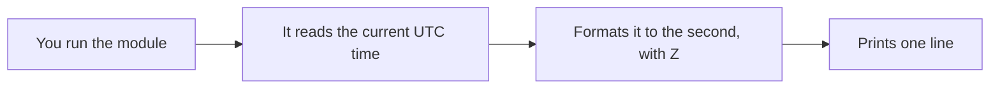

# Hello-Cadence — Current Time Printer

## Why

This is the canonical Cadence worked example. It exists so first-time Cadence users can read a complete design and plan end to end and see what "done" looks like. It is a teaching artifact: real projects should not copy the feature.

## What it does

A small Python module prints the current time in one standard format. You run it and see one line: the time in UTC, to the second, ending in `Z`. Other code can ask the module for the same string instead of printing it.

There are no flags, no configuration, and no logging. If the system clock can't be read, the error reaches the caller unchanged: the module doesn't guess a time.

## Examples and wording

- Run at 14:30:00 UTC on 15 January 2026 → prints `2026-01-15T14:30:00Z`.
- Run at 14:30:00.123456 UTC → still prints `2026-01-15T14:30:00Z` (no fractions of a second).
- Run on a machine set to UTC−7 → prints the UTC time, never the local one.

## Visuals

## Decisions

1. D1 — Always UTC, read from the current, non-deprecated time interface. Why: the deprecated path warns on newer Python versions, and the example shouldn't teach a bad habit.
2. D2 — Output is `YYYY-MM-DDTHH:MM:SSZ`, with no fractions of a second. Why: readable, sorts as text, and no noise for an example.
3. D3 — No command-line library; running the module just prints the time. Why: the example demonstrates Cadence, not argument parsing.

## Out of scope

- **Local-timezone output, or picking a timezone.** Why: UTC is unambiguous; local time invites "wrong hour" bugs. Surfaced in: D1.
- **A configurable format.** Why: adds surface area without teaching anything about Cadence. Surfaced in: D2.
- **Command-line flags.** Why: the example demonstrates Cadence, not CLI libraries. Surfaced in: D3.
