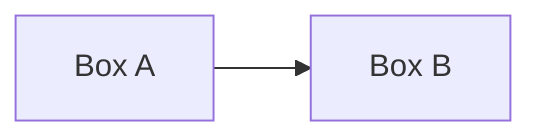
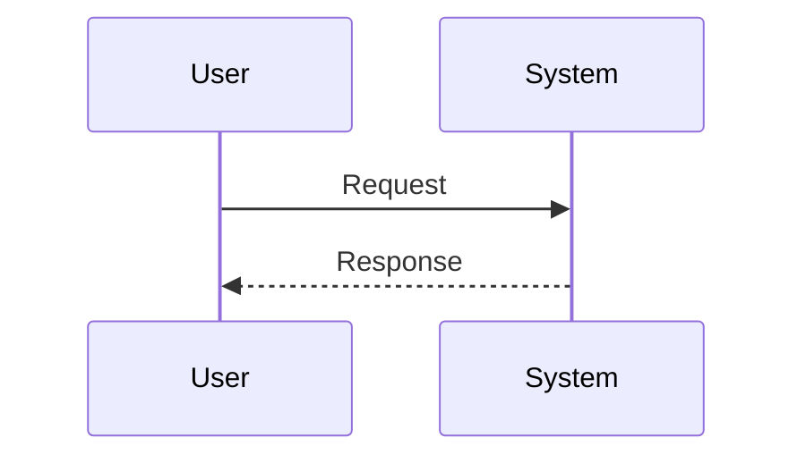

# Architecture Diagrams

Dense diagrams for an opt-in reader. Diagrams that decide something a reviewer must see live inline in [[00-overview#Visuals]].

## <Diagram name 1>

<One-paragraph description of what the diagram shows and why it matters.>

## <Diagram name 2>

